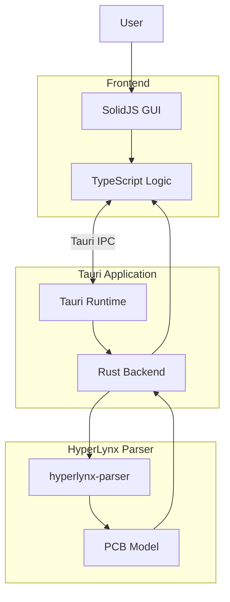

# Architecture

This document describes the internal architecture of GPUPCB, its main components and how they interact.

GPUPCB is a multiplatform application that can be run on Windows, macOS, Linux and even in Browser.

Its technological stack was chosen to support this requirement:

| Component | Technology | Role |
|---|---|---|
| Frontend | SolidJS, TypeScript | GUI and application interaction |
| Frontend tooling | Vite | Development server and frontend build |
| Desktop runtime | Tauri v2 | Native desktop application integration |
| Backend | Rust | Application logic |
| HyperLynx parser | Rust | Parsing HyperLynx files |
| GPU connection | wgpu | Performing simultaneous computations |

## Technology Choices

GPUPCB is built using a combination of web technologies and Rust, with an emphasis on cross-platform compatibility, performance, and code reusability.

### Tauri

Tauri provides desktop application integration, allowing GPUPCB to be packaged and distributed as a desktop application across major desktop operating systems, including Windows, macOS and Linux.

It handles the integration between the frontend and the native application backend, enabling the same application GUI to be used in Browser version of the app.

### SolidJS and TypeScript

The GUI is developed using SolidJS and TypeScript.

The frontend is not limited to the desktop application. It can also run independently in a web browser, allowing GPUPCB to work in browser and desktop while sharing the same GUI codebase.

### Rust

Rust is the primary programming language for GPUPCB's logic.

Its choice was driven by several important characteristics:

- **Memory safety:** Rust's ownership and borrowing system prevent memory-related errors at compile time without requiring additional garbage collector.
- **Tauri integration:** Rust is the native backend language used by Tauri, making it a natural fit for desktop application development.
- **WebAssembly support:** Rust provides great WebAssembly tooling, allowing application logic to be compiled for browser environments.
- **GPU computing:** The [wgpu](https://wgpu.rs/) library provides a Rust implementation of the WebGPU API, offering a cross-platform abstraction for GPU computations.

## Diagram od desktop version relationships

### Frontend
#### Location: src/

Frontend is responsible for the GUI and User interaction.

#### Technologies:
- SolidJS
- TypeScript
- Vite

The Frontend communicates with the native application through the Tauri IPC (or WASM in web version).

Its responsibilities are:

- Rendering the interface.
- Managing application interaction and UI state.
- Providing access to application's functionalities.
- Presenting parsed PCB data and simulation results.

### Desktop Application
#### Location: src-tauri/

GPUPCB uses Tauri v2 to package Frontend into a native desktop application.

Tauri provides communication between the frontend and Rust backend, as well as access to native OS functionalities.

The application currently integrates the following plugins:

| Plugin | Purpose 
|---|---|
| Dialog | Native file dialogs |
| Filesystem (fs) | Access to Filesystem |

The Tauri application initializes the runtime, registers plugins and exposes Backend commands to Frontend.

### Backend
#### Location: src-tauri/src/

The Rust backend handles native application functionality.

Its responsibilities are:

- Processing requests from Frontend.
- Reading files from the filesystem.
- Calling the HyperLynx parser.
- Returning parsed PCB data.
- Handling filesystem errors.

#### Frontend communication
- The backend exposes functionalities through Tauri commands.

E.G. the *load_hyperlynx_file* command loads a HyperLynx file and passes its contents to the HyperLynx Parser.

The command returns either a parsed PCB model or a custom parsing error.

### HyperLynx Parser
#### Location: crates/hyperlynx-parser/

The HyperLynx parser is a separate Rust crate responsible for reading PCB design data exported in HyperLynx format.

It is maintained independently from the application's backend.

#### The parser uses:

- Rust
- [winnow](https://docs.rs/winnow/latest/winnow/) as a parser combinator library
- [serde](https://crates.io/crates/serde) for data serialization

#### Parsing workflow
1. Application receives a request to load a PCB file.
2. Backend reads the file.
3. Parser processes the HyperLynx data.
4. Parser produces a PCB board model.
5. Backend returns the result to the application.

## GPU Simulations and Computing

### The project's simulation goals include:

- Electromagnetic field computation.
- Finite-Difference Time-Domain (FDTD) simulation.
- Finite-Difference Frequency-Domain (FDFD) simulation.
- Interactive 3D visualization.
- Signal and power integrity analysis.
